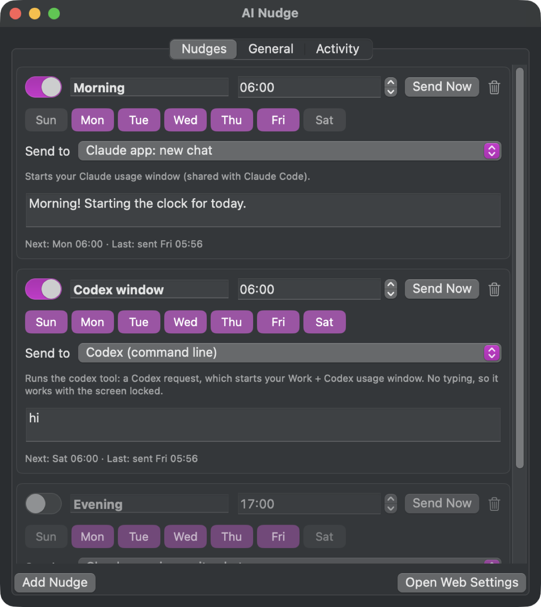
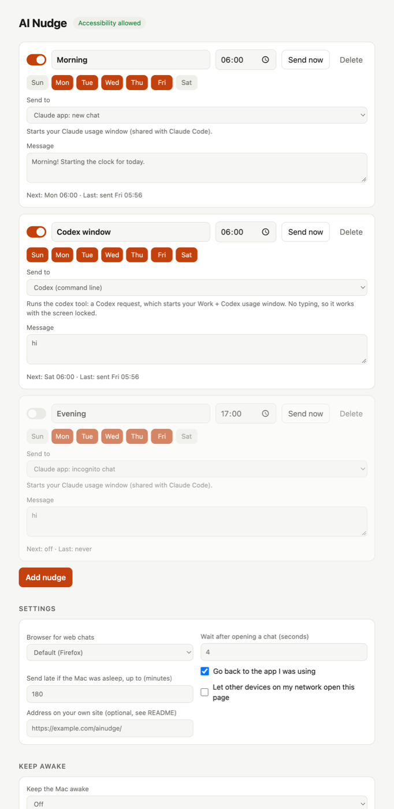
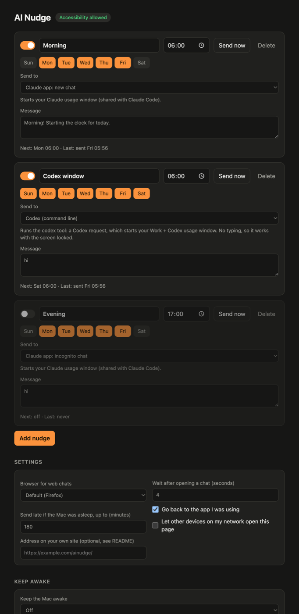

# AI Nudge

A tiny macOS menu bar app that sends a message to **Claude** or **Codex** at the times you choose,
so your plan's usage window starts before you sit down. Send "hi" at 06:00 and a 5-hour window
resets at 11:00, not five hours after you first type.

For Claude it sends the message the way you would: it opens the chat, puts in your text and
presses Return. For Codex it sends a request through the `codex` tool that comes with the ChatGPT
app. Both count against your subscription's limits; API calls don't. It also has a
Caffeine-style **Keep Awake**.

About 500 KB, no dependencies, no account, nothing leaves your Mac except the messages you schedule.

<p align="center">
  
</p>

> Want it headless, working with the screen locked? See
> **[ai-nudge-cli](https://github.com/sbd1017/ai-nudge-cli)**, which does the same through the
> Claude Code and Codex command-line tools.

## Features

- **Nudges on a schedule:** a time, the days of the week, where it goes and what it says. Add as
  many as you like.
- **Claude (app or browser) and Codex:**

  | Send to | How it gets there |
  | --- | --- |
  | Claude app: new chat | opens `claude://claude.ai/new?q=…`, which fills in the message, then presses Return |
  | Claude app: incognito chat | opens a new chat, presses ⇧⌘I, pastes, presses Return |
  | Claude app: a chat you pick | opens `claude://claude.ai/chat/<id>`, pastes, presses Return |
  | claude.ai in a browser: new / incognito / a chat you pick | `claude.ai/new?q=…`, `/new?incognito` or `/chat/<id>` |
  | Any link | opens it (`{message}` is replaced with your text), pastes unless the link carried it, presses Return |
  | Claude Code (command line) | runs `claude -p` (Claude Code, which comes with the Claude app); no typing |
  | Codex (command line) | runs `codex exec` (Codex, which comes with the ChatGPT app); no typing |

  **Which window starts:** any Claude target starts your Claude usage window, which is shared with
  Claude Code. The **Codex** target starts the Work + Codex allowance, which begins with your first
  Work or Codex request. A ChatGPT chat message doesn't start it, so AI Nudge no longer sends
  ChatGPT chats; nudges saved with the old ChatGPT targets switch to Codex. Each target's note in
  Settings says which window it starts. The two command-line targets need no Accessibility permission and
  work with the screen locked (the Mac still has to be awake).

- **Settings on the Mac and on the web:** a native settings window from the menu bar, plus the same
  settings as a web page you can open from your phone at home, or from anywhere through your own
  site.
- **Keep Awake:** indefinitely, for 15 minutes to 8 hours, or until after the next nudge. It can
  let the display sleep, and it stops when the battery is low.
- **Careful typing:**
  - It only types once the chat is in front, and stops if you click or type while it's sending.
  - Scheduled nudges wait until you've been idle for 30 seconds.
  - Your clipboard and the app you were using are put back afterwards.
- **Sleep and lock aware:** a nudge missed while the Mac slept is sent when it wakes, up to 3 hours
  late by default. If the screen is locked, it waits until you unlock.

<p align="center">
  
  
</p>

## Install

### Download

1. Download `AI-Nudge-<version>.zip` from [Releases](https://github.com/sbd1017/ai-nudge/releases),
   unzip it and move **AI Nudge.app** to Applications.
2. The app isn't notarized, so the first time, right-click it and choose **Open**. Or run
   `xattr -dr com.apple.quarantine "/Applications/AI Nudge.app"`.
3. When asked, allow AI Nudge in **System Settings › Privacy & Security › Accessibility**. It
   needs this to press keys. Nothing gets sent without it.

### Build it yourself

Needs macOS 13 or later and Xcode (or its command-line tools).

```sh
git clone https://github.com/sbd1017/ai-nudge.git
cd ai-nudge
make install      # builds "AI Nudge.app" into ~/Applications and opens it
```

`build.sh` signs the app with your Apple Development certificate if you have one, so macOS keeps
the Accessibility permission across rebuilds. With ad hoc signing (`SIGN_IDENTITY=-`) you have to
grant it again after each build. `UNIVERSAL=1 ./build.sh` builds for Apple silicon and Intel.

## Use

1. Click the timer in the menu bar and choose **Settings…**.
2. Edit the sample nudge or add your own: name, time, days, where to send it and the message.
   Changes save as you type.
3. Choose **Send Now** to try it.
4. Switch on **Open at Login** in the menu.

The menu also switches nudges on and off, has **Keep Awake**, and opens the web settings.

For "a chat you pick", paste the chat's link from the address bar or the share menu.

### From your phone

- **At home:** in Settings › General, switch on **Let other devices on my network open the web
  settings**, then use **Copy Link for Other Devices**. The link includes a secret, so only people
  you give it to can open it.
- **From anywhere:** put the page behind a login on a site you already run, with a reverse proxy.
  Then enter that address under **Address on your own site**, and the menu's **Copy Link for Your
  Site** gives you the link. The page uses relative addresses and no inline scripts, so a sub-path
  and a strict Content-Security-Policy both work. An nginx example:

  ```nginx
  location ^~ /ainudge/ {
      # your site's login here (auth_request, auth_basic, ...)
      proxy_pass http://192.168.1.20:47823/;   # the Mac; give it a fixed address on your router
      proxy_set_header Cookie "";
      proxy_set_header Authorization "";
  }
  ```

  If your site limits methods, allow `PUT …/api/config` and `POST …/api/send`, `…/api/awake` and
  `…/api/accessibility`. AI Nudge still requires its own secret on top of your login: either use the
  link from the menu, or have the proxy add it (`proxy_set_header X-Token "<secret>";`, kept in a
  file only root can read) so the plain address works once you've signed in. The secret is the
  `token` in `~/Library/Application Support/ai-nudge/config.json`.

## Good to know

- **The Mac has to be awake and unlocked.** AI Nudge types into the app like a person, which it
  can't do on a sleeping or locked Mac. Missed nudges go out when you wake or unlock it, within the
  catch-up window. Keep Awake helps; for a 06:00 nudge with the Mac closed, use
  [ai-nudge-cli](https://github.com/sbd1017/ai-nudge-cli).
- **Apps change.** The deep links and shortcuts above match the Claude app as of
  October 2026. If one stops working, the nudge's card says why, and a longer **Wait after opening
  a chat** often helps on slower Macs.
- **Terms of use.** This automates the chat apps' own interfaces, at the pace of a person sending
  a message or two a day. Check that you're comfortable with your provider's terms. The CLI
  version uses the providers' own command-line tools instead.
- **Files:** settings in `~/Library/Application Support/ai-nudge/`, log in
  `~/Library/Logs/ai-nudge.log`. Set `AI_NUDGE_DATA=/some/folder` to run on separate data.
- **Privacy:** the settings page listens on `127.0.0.1` unless you allow your network, and every
  request needs the secret in your link. Nothing is sent anywhere else.

## How it works

```
Sources/AINudge/
  App.swift           menu bar menu, Keep Awake menu, settings window scene
  SettingsView.swift  the native settings window
  Store.swift         settings, schedule checks (every 20 s, on wake and on unlock), activity log
  Schedule.swift      when a nudge is due: last and next occurrence, days
  Sender.swift        opens the chat, checks it's in front, pastes, presses Return
  KeepAwake.swift     IOKit power assertions
  WebServer.swift     the settings page and its JSON API (Network.framework)
  SettingsPage.swift  the page's HTML, CSS and script
```

## License

MIT. See [LICENSE](LICENSE).
